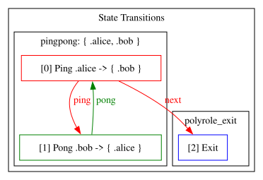
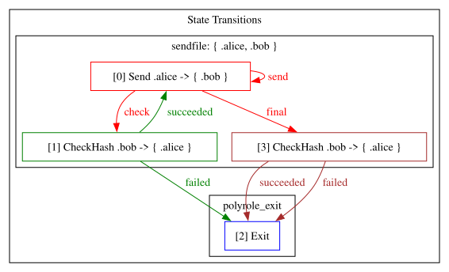
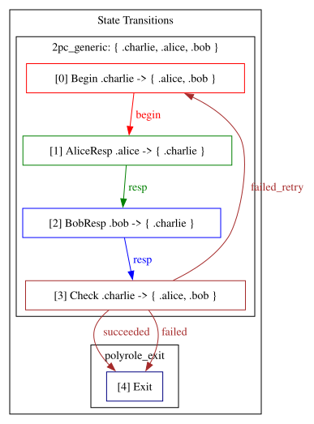
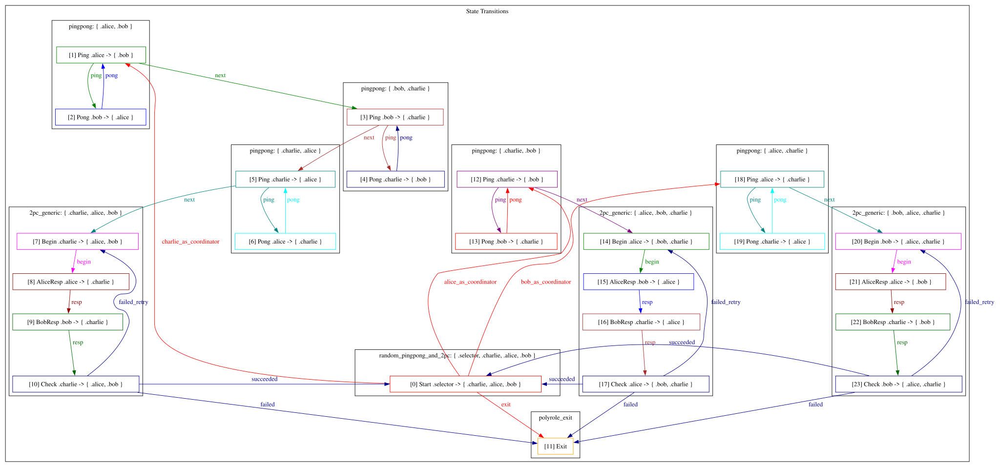

# Polyrole

Polyrole is a multi-role state machine library built on Zig's type system. A protocol is a deterministic state graph: states are tagged unions, transitions are type parameters, and each role's behavior is dispatched by its role. Roles may run in one thread, in separate threads, or across a network; communication is isolated behind replaceable channels.

## Protocol as a State Graph

A state is a `union(enum)` whose fields are the possible messages. `Data(Payload, NextState)` carries the payload and names the state to enter after the message moves:

```zig
const Ping = union(enum) {
    ping: Data(i32, Pong),
    next: Data(void, NextState),
};

const Pong = union(enum) {
    pong: Data(i32, Ping),
};
```

Every state also carries `info`: `sender` and `receiver`, while `@TypeOf(info)` holds the protocol-wide `internal_roles` and `extern_state`.

## How a Role Runs

`symmetric_run` drives one role:

- **sender**: calls `process` to produce the message, sends it to every `receiver`, then advances to the message's `NextState`.
- **receiver**: receives the message, calls `preprocess_N` (N is its position in `receiver`), then advances.
- **non-participant**: executes nothing and waits for a `Notify` that moves it to the next state.

Each role therefore follows one deterministic path through the graph.

The protocol does not depend on networking: `simulate` runs every role in one thread without channels, `symmetric_run` adds channels, and `RoleRunner` exposes one step so an event loop or scheduler can drive it.

## Branches and Notification

A state with more than one union field is a branch, and only the sender knows which one was chosen. The library therefore requires `1 + receiver.len == internal_roles.len`: every other internal role must receive the message, so none can miss the new state.

When the next state is in `extern_state` (or is `Exit`), `internal_roles[0]` sends `Notify` to every role outside `internal_roles`, and those roles jump to the new state. Protocol hand-over stays synchronized without polling.

## Composition

A protocol composes by using another protocol's entry state as a `NextState`:

```zig
charlie_as_coordinator: Data(void,
    PingPong(.alice, .bob, PingPong(.bob, .charlie, CAB(@This()).Begin).Ping).Ping),
```

At compile time `reachableStates` expands the nesting into one state graph and validates it: senders and receivers belong to `internal_roles`, receivers exclude the sender and are unique, branch states satisfy the notification rule, and every state shares the same per-role context types. A protocol that compiles is a legal state machine.

## Context

A top-level `Context` gives each role one field holding everything that role needs, and handlers receive that field through `info.Ctx(role)`. Protocols share a role's data without open-coding globals.

## Adding polyrole

Requires Zig 0.17.0.

```shell
zig fetch --save git+https://github.com/sdzx-1/polyrole.git
```

Then in `build.zig`:

```zig
const polyrole = b.dependency("polyrole", .{ .target = target, .optimize = optimize });
exe_mod.addImport("polyrole", polyrole.module("root"));
```

```zig
const polyrole = @import("polyrole");
```

## Examples

### pingpong

`zig build pingpong` — Alice and Bob exchange a counter until the protocol exits. Two states point at each other, and a `next` branch leaves the loop.

The protocol lives in [`examples/protocols/pingpong.zig`](./examples/protocols/pingpong.zig), with the entry point in [`examples/pingpong.zig`](./examples/pingpong.zig).



### sendfile

`zig build sendfile` — Alice streams a file to Bob over TCP in 4 KB chunks and sends a hash every 20 MiB; Bob verifies it.

The `Send` state loops on itself for streaming, and `CheckHash(Success, Failure)` is a parameterized state template reused for checkpoints and the final chunk.

See [`examples/protocols/sendfile.zig`](./examples/protocols/sendfile.zig) and [`examples/sendfile.zig`](./examples/sendfile.zig).



### 2pc

`zig build 2pc` — Charlie coordinates a transaction between Alice and Bob; both vote randomly, and the coordinator commits, retries, or aborts.

See [`examples/protocols/two_phase_commit.zig`](./examples/protocols/two_phase_commit.zig) and [`examples/2pc.zig`](./examples/2pc.zig).



### random-pingpong-2pc

`zig build random-pingpong-2pc` — a Selector picks one of three composite paths for 300 rounds, each chaining pingpong exchanges into a two-phase commit with a different coordinator.

See [`examples/random_pingpong_2pc.zig`](./examples/random_pingpong_2pc.zig) and [`examples/protocols/`](./examples/protocols/).


